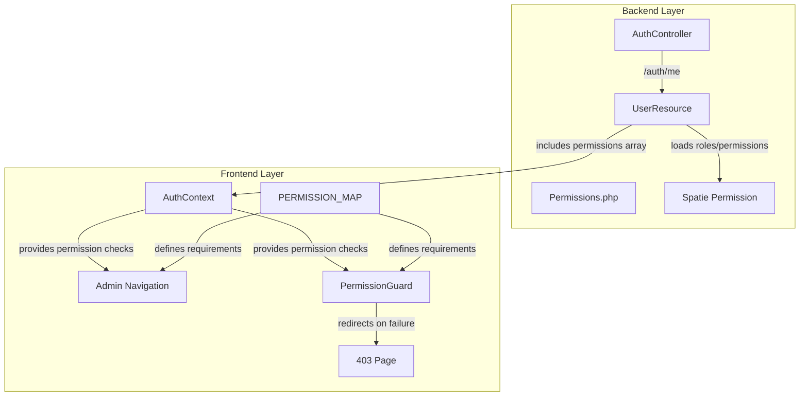

# Design Document: Role-Based Admin Navigation

## Overview

This design implements permission-based filtering for admin navigation and route protection in the Gosika E-commerce platform. The system extends the existing Spatie Laravel Permission infrastructure to expose user permissions via the authentication API, implements permission-checking utilities in the React frontend, filters navigation items based on user permissions, and blocks unauthorized route access with appropriate user feedback.

### Goals

- Extend backend UserResource to include user permissions array
- Enhance frontend AuthContext with permission-checking functions
- Create centralized permission mapping for navigation items
- Filter admin navigation based on user permissions (desktop and mobile)
- Implement route-level permission guards
- Provide clear unauthorized access feedback (403 page)
- Maintain super_admin bypass logic throughout
- Ensure zero performance impact on navigation rendering

### Non-Goals

- Modifying the Spatie Permission package configuration
- Implementing permission management UI (handled by existing AdminRoles page)
- Adding permission checks to individual API endpoints (already handled by Laravel middleware)
- Implementing audit logging for permission checks (handled by backend)
- Creating new permission types beyond what exists in Permissions.php

## Architecture

### System Components



### Data Flow

1. **User Authentication**
   - User authenticates via `/auth/login` or session restoration via `/auth/me`
   - Backend loads user with `roles` and `permissions` relationships
   - UserResource serializes permissions as array of strings
   - Frontend stores user data in AuthContext

2. **Navigation Rendering**
   - Admin portal mounts, reads ADMIN_NAV and PERMISSION_MAP
   - For each navigation item, checks if user has required permissions
   - Filters out unauthorized items
   - Renders filtered navigation (desktop sidebar and mobile bottom nav)

3. **Route Access**
   - User navigates to protected route
   - PermissionGuard reads route's permission requirements from PERMISSION_MAP
   - Checks user permissions via AuthContext
   - Allows access or redirects to 403 Unauthorized page

## Components and Interfaces

### Backend Components

#### 1. UserResource Extension

**File:** `app/Modules/Identity/Presentation/Resources/UserResource.php`

**Changes:**
- Add `permissions` field to `toArray()` method
- Load `roles` and `permissions` relationships
- For super_admin role, return `Permissions::ALL`
- For other roles, return actual assigned permissions via Spatie

**Interface:**
```php
public function toArray(Request $request): array
{
    return [
        // ... existing fields
        'roles' => $this->whenLoaded('roles', fn () => $this->roles->pluck('name')),
        'permissions' => $this->whenLoaded('roles', function () {
            if ($this->hasRole('super_admin')) {
                return Permissions::ALL;
            }
            return $this->getAllPermissions()->pluck('name')->toArray();
        }),
    ];
}
```

#### 2. AuthController Modification

**File:** `app/Modules/Identity/Presentation/Http/Controllers/AuthController.php`

**Changes:**
- Update `login()` method to eager load `roles` relationship
- Update `me()` method to eager load `roles` relationship

**Interface:**
```php
public function login(LoginRequest $request): JsonResponse
{
    $user = $this->auth->login(LoginDTO::fromArray($request->validated()));
    return Response::success([
        'user' => new UserResource($user->load('roles')),
        'token' => $this->auth->createToken($user, $request->input('device_name')),
    ], 'Login successful.');
}

public function me(Request $request): JsonResponse
{
    return Response::success(
        new UserResource($request->user()->load('roles')), 
        'Authenticated user.'
    );
}
```

### Frontend Components

#### 3. AuthContext Enhancement

**File:** `frontend/src/context/AuthContext.jsx`

**New State:**
```javascript
const permissions = useMemo(() => {
  if (!user?.permissions) return new Set()
  return new Set(user.permissions)
}, [user])
```

**New Functions:**
```javascript
/**
 * Check if user has a specific permission
 * @param {string} permission - Permission string (e.g., 'orders.view')
 * @returns {boolean}
 */
const hasPermission = useCallback((permission) => {
  if (!user) return false
  if (isSuperAdmin()) return true
  return permissions.has(permission)
}, [user, permissions, isSuperAdmin])

/**
 * Check if user has any of the specified permissions
 * @param {string[]} permissionList - Array of permission strings
 * @returns {boolean}
 */
const hasAnyPermission = useCallback((permissionList) => {
  if (!user) return false
  if (isSuperAdmin()) return true
  return permissionList.some(p => permissions.has(p))
}, [user, permissions, isSuperAdmin])

/**
 * Check if user has all of the specified permissions
 * @param {string[]} permissionList - Array of permission strings
 * @returns {boolean}
 */
const hasAllPermissions = useCallback((permissionList) => {
  if (!user) return false
  if (isSuperAdmin()) return true
  return permissionList.every(p => permissions.has(p))
}, [user, permissions, isSuperAdmin])
```

**Exposed API:**
```javascript
const value = useMemo(() => ({
  user,
  booted,
  permissions,
  login,
  saveSession,
  logout,
  updateUser,
  refreshUser,
  reloadUser,
  isVendor,
  isSuperAdmin,
  isDeliveryPartner,
  isCustomer,
  hasPermission,
  hasAnyPermission,
  hasAllPermissions,
}), [/* dependencies */])
```

#### 4. Permission Map

**File:** `frontend/src/utils/constants.js`

**Structure:**
```javascript
/**
 * Permission requirements for admin navigation items and routes
 * Maps route paths to required permissions
 * 
 * @typedef {Object} PermissionMapEntry
 * @property {string|string[]} permissions - Single permission or array of alternative permissions (OR logic)
 * @property {boolean} [requireAll] - If true, requires ALL permissions (AND logic). Default: false (OR logic)
 */
export const ADMIN_PERMISSION_MAP = {
  // Overview
  '/admin': null, // Dashboard accessible to all admins
  '/admin/analytics/reports': ['analytics.view'],
  
  // Orders
  '/admin/orders': ['orders.view'],
  '/admin/orders/returns': ['orders.view', 'orders.manage'],
  '/admin/orders/refunds': ['orders.refund'],
  
  // Catalog
  '/admin/marketplace/products': ['products.view'],
  '/admin/marketplace/categories': ['categories.manage'],
  '/admin/marketplace/brands': ['brands.manage'],
  '/admin/marketplace/reviews': ['products.view'],
  
  // Marketplace
  '/admin/marketplace/vendors': ['vendors.view'],
  '/admin/marketplace/kyc': ['vendor_kyc.review'],
  '/admin/marketplace/stores': ['stores.view'],
  '/admin/marketplace/tiers': ['vendors.view'],
  '/admin/marketplace/bulletins': ['vendors.view'],
  
  // Customers
  '/admin/customers': ['users.view'],
  '/admin/customers/support': ['tickets.view'],
  
  // Logistics
  '/admin/fulfillment/dashboard': ['deliveries.manage'],
  '/admin/fulfillment/partners': ['delivery_partners.manage'],
  '/admin/fulfillment/assignments': ['deliveries.manage'],
  '/admin/fulfillment/zones': ['deliveries.manage'],
  '/admin/fulfillment/cod': ['payments.view', 'reconciliation.manage'],
  
  // Finance
  '/admin/finance/payments': ['payments.view'],
  '/admin/finance/commissions': ['payments.view'],
  '/admin/finance/payouts': ['payouts.approve'],
  '/admin/finance/settlements': ['settlements.manage'],
  
  // Marketing
  '/admin/marketing/campaigns': ['campaigns.manage'],
  '/admin/marketing/nominations': ['promotions.manage'],
  '/admin/marketing/coupons': ['coupons.manage'],
  '/admin/marketing/banners': ['banners.manage'],
  '/admin/marketing/pages': ['pages.manage'],
  '/admin/seo': ['pages.manage'],
  
  // Administration
  '/admin/system/notifications': null, // All admins
  '/admin/system/settings': ['settings.manage'],
  '/admin/system/gateways': ['settings.manage'],
  '/admin/system/users': ['users.view'],
  '/admin/system/roles': ['users.manage_roles'],
  '/admin/system/audit-logs': ['users.view'],
  '/admin/system/logs': ['settings.manage'],
  '/admin/profile': null, // All admins
}
```

#### 5. Navigation Filter Utility

**File:** `frontend/src/utils/navigationFilter.js`

```javascript
/**
 * Filter navigation items based on user permissions
 * @param {Array} navItems - Navigation items from ADMIN_NAV or ADMIN_MOBILE_NAV
 * @param {Object} permissionMap - ADMIN_PERMISSION_MAP
 * @param {Function} hasPermission - Permission check function from AuthContext
 * @param {Function} hasAnyPermission - Permission check function from AuthContext
 * @param {Function} hasAllPermissions - Permission check function from AuthContext
 * @param {boolean} isSuperAdmin - Whether user is super admin
 * @returns {Array} Filtered navigation items
 */
export function filterNavigation(
  navItems,
  permissionMap,
  { hasPermission, hasAnyPermission, hasAllPermissions, isSuperAdmin }
) {
  // Super admin sees everything
  if (isSuperAdmin) return navItems

  const filtered = []
  let lastSection = null

  for (const item of navItems) {
    // Section headers: include if at least one item in section is visible
    if (item.section) {
      lastSection = item
      continue
    }

    // Check permission requirements
    const requiredPerms = permissionMap[item.to]
    
    // No requirements = accessible to all admins
    if (requiredPerms === null || requiredPerms === undefined) {
      if (lastSection) {
        filtered.push(lastSection)
        lastSection = null
      }
      filtered.push(item)
      continue
    }

    // Single permission string
    if (typeof requiredPerms === 'string') {
      if (hasPermission(requiredPerms)) {
        if (lastSection) {
          filtered.push(lastSection)
          lastSection = null
        }
        filtered.push(item)
      }
      continue
    }

    // Array of permissions
    if (Array.isArray(requiredPerms)) {
      const hasAccess = item.requireAll
        ? hasAllPermissions(requiredPerms)
        : hasAnyPermission(requiredPerms)

      if (hasAccess) {
        if (lastSection) {
          filtered.push(lastSection)
          lastSection = null
        }
        filtered.push(item)
      }
    }
  }

  return filtered
}
```

#### 6. PermissionGuard Component

**File:** `frontend/src/components/layout/PermissionGuard.jsx`

```javascript
import { Navigate } from 'react-router-dom'
import { useAuth } from '../../context/AuthContext'
import { ADMIN_PERMISSION_MAP } from '../../utils/constants'

/**
 * Route guard that checks user permissions before rendering children
 * Redirects to 403 Unauthorized if user lacks required permissions
 */
export function PermissionGuard({ children, route }) {
  const { isSuperAdmin, hasPermission, hasAnyPermission, hasAllPermissions, booted } = useAuth()

  // Wait for auth to boot
  if (!booted) {
    return <div className="flex items-center justify-center h-screen">Loading...</div>
  }

  // Super admin has access to everything
  if (isSuperAdmin()) {
    return children
  }

  // Check permission requirements for this route
  const requiredPerms = ADMIN_PERMISSION_MAP[route]

  // No requirements = accessible to all authenticated admins
  if (requiredPerms === null || requiredPerms === undefined) {
    return children
  }

  // Single permission string
  if (typeof requiredPerms === 'string') {
    if (!hasPermission(requiredPerms)) {
      return <Navigate to="/admin/unauthorized" replace />
    }
    return children
  }

  // Array of permissions
  if (Array.isArray(requiredPerms)) {
    const requireAll = ADMIN_PERMISSION_MAP[route]?.requireAll || false
    const hasAccess = requireAll
      ? hasAllPermissions(requiredPerms)
      : hasAnyPermission(requiredPerms)

    if (!hasAccess) {
      return <Navigate to="/admin/unauthorized" replace />
    }
    return children
  }

  return children
}
```

#### 7. Unauthorized Page Component

**File:** `frontend/src/pages/admin/Unauthorized.jsx`

```javascript
import { useNavigate } from 'react-router-dom'
import { ShieldAlert } from 'lucide-react'

export default function Unauthorized() {
  const navigate = useNavigate()

  return (
    <div className="flex flex-col items-center justify-center min-h-[70vh] px-4">
      <div className="text-center max-w-md">
        <div className="inline-flex items-center justify-center w-16 h-16 mb-6 rounded-full bg-red-100">
          <ShieldAlert className="w-8 h-8 text-red-600" />
        </div>
        
        <h1 className="text-3xl font-bold text-gray-900 mb-4">
          Access Denied
        </h1>
        
        <p className="text-lg text-gray-600 mb-8">
          You don't have permission to access this page.
        </p>
        
        <div className="flex flex-col sm:flex-row gap-4 justify-center">
          <button
            onClick={() => navigate('/admin')}
            className="px-6 py-3 bg-blue-600 text-white rounded-lg hover:bg-blue-700 transition-colors font-medium"
          >
            Go to Dashboard
          </button>
          
          <button
            onClick={() => navigate('/admin/system/users')}
            className="px-6 py-3 bg-gray-100 text-gray-700 rounded-lg hover:bg-gray-200 transition-colors font-medium"
          >
            Contact Administrator
          </button>
        </div>
      </div>
    </div>
  )
}
```

#### 8. DashboardLayout Integration

**File:** `frontend/src/components/layout/DashboardLayout.jsx`

**Changes:**
- Import and use `filterNavigation` utility
- Filter `nav` prop before rendering
- Filter `mobileNav` prop before rendering
- Handle loading state during auth boot

**Implementation:**
```javascript
import { filterNavigation } from '../../utils/navigationFilter'
import { ADMIN_PERMISSION_MAP } from '../../utils/constants'
import { useAuth } from '../../context/AuthContext'

function DashboardLayout({ nav, mobileNav, title, roleLabel }) {
  const { hasPermission, hasAnyPermission, hasAllPermissions, isSuperAdmin, booted } = useAuth()

  const filteredNav = useMemo(() => {
    if (!booted) return []
    return filterNavigation(nav, ADMIN_PERMISSION_MAP, {
      hasPermission,
      hasAnyPermission,
      hasAllPermissions,
      isSuperAdmin: isSuperAdmin(),
    })
  }, [nav, booted, hasPermission, hasAnyPermission, hasAllPermissions, isSuperAdmin])

  const filteredMobileNav = useMemo(() => {
    if (!booted || !mobileNav) return []
    return filterNavigation(mobileNav, ADMIN_PERMISSION_MAP, {
      hasPermission,
      hasAnyPermission,
      hasAllPermissions,
      isSuperAdmin: isSuperAdmin(),
    })
  }, [mobileNav, booted, hasPermission, hasAnyPermission, hasAllPermissions, isSuperAdmin])

  // Render with filteredNav and filteredMobileNav
  // ...
}
```

## Data Models

### User Permission Data

**Backend Model (UserResource response):**
```typescript
interface UserResource {
  id: string
  first_name: string
  last_name: string
  name: string
  full_name: string
  email: string
  phone: string | null
  avatar: string | null
  status: string
  email_verified_at: string | null
  phone_verified_at: string | null
  roles: string[]
  permissions: string[] // NEW: Array of permission strings
  address: object | null
  meta: object
  created_at: string
}
```

**Frontend AuthContext State:**
```typescript
interface AuthContextValue {
  user: UserResource | null
  booted: boolean
  permissions: Set<string> // NEW: Set for O(1) lookup
  login: (email: string, password: string) => Promise<UserResource>
  saveSession: (token: string, userData: UserResource) => void
  logout: () => Promise<void>
  updateUser: (patch: Partial<UserResource> | ((prev: UserResource) => UserResource)) => void
  refreshUser: () => Promise<UserResource | null>
  reloadUser: () => Promise<UserResource | null>
  isVendor: () => boolean
  isSuperAdmin: () => boolean
  isDeliveryPartner: () => boolean
  isCustomer: () => boolean
  hasPermission: (permission: string) => boolean // NEW
  hasAnyPermission: (permissions: string[]) => boolean // NEW
  hasAllPermissions: (permissions: string[]) => boolean // NEW
}
```

### Navigation Item Model

```typescript
interface NavigationItem {
  section?: string // Section header text
  to?: string // Route path
  label?: string // Display label
  icon?: string // Lucide icon name
  end?: boolean // Exact route match
  requireAll?: boolean // Require all permissions (AND logic) instead of any (OR logic)
}

interface PermissionMapEntry {
  [routePath: string]: string | string[] | null
  // null = accessible to all authenticated admins
  // string = single required permission
  // string[] = array of alternative permissions (OR logic by default, AND if requireAll: true)
}
```

## Error Handling

### Backend Error Scenarios

1. **User Not Found (401)**
   - Scenario: Token invalid or expired
   - Handling: AuthContext catches 401, clears local storage, redirects to login
   - User Experience: Seamless redirect to login page

2. **Permission Loading Failure**
   - Scenario: Database connection issue when loading permissions
   - Handling: Laravel exception handler returns 500, frontend treats as empty permissions
   - User Experience: User sees only dashboard link (minimal access)

3. **Super Admin Check Failure**
   - Scenario: Role check fails due to missing data
   - Handling: Defaults to regular permission checking (fail-safe)
   - User Experience: Navigation filtered based on actual permissions

### Frontend Error Scenarios

1. **Auth Not Booted**
   - Scenario: User object not yet loaded from `/auth/me`
   - Handling: Show loading skeleton, defer navigation rendering
   - User Experience: Brief loading state, then navigation appears

2. **Missing Permission in Map**
   - Scenario: Route not defined in ADMIN_PERMISSION_MAP
   - Handling: Treat as `null` (accessible to all admins)
   - User Experience: Route remains accessible

3. **Permission Array Empty**
   - Scenario: User has no permissions assigned
   - Handling: Filter out all items except those with `null` requirements
   - User Experience: User sees only dashboard and profile links

4. **Invalid Permission String**
   - Scenario: Permission in map doesn't exist in backend
   - Handling: hasPermission returns false (fail-safe)
   - User Experience: Navigation item hidden

5. **Role Changed Mid-Session**
   - Scenario: Admin revokes user's role while they're logged in
   - Handling: Permissions cached until next `/auth/me` call (on refresh or explicit reload)
   - User Experience: User retains access until next page reload

6. **Direct URL Access After Permission Revocation**
   - Scenario: User bookmarks protected route, permission later revoked
   - Handling: PermissionGuard checks on route load, redirects to 403
   - User Experience: Clear "Access Denied" message with options

## Testing Strategy

### Unit Tests

**Backend Tests (PHPUnit):**

1. **UserResource Permission Serialization**
   - Test: Super admin receives all permissions
   - Test: Regular admin receives only assigned permissions
   - Test: User with no permissions receives empty array
   - Test: Permissions are loaded with roles relationship
   - Framework: PHPUnit with database factories

2. **AuthController Integration**
   - Test: `/auth/me` returns permissions array
   - Test: `/auth/login` returns permissions array
   - Test: Response matches UserResource schema
   - Framework: Feature tests with JSON assertions

**Frontend Tests (Vitest + React Testing Library):**

1. **AuthContext Permission Functions**
   - Test: `hasPermission` returns true for assigned permission
   - Test: `hasPermission` returns false for missing permission
   - Test: `hasAnyPermission` returns true if user has at least one
   - Test: `hasAllPermissions` returns true only if user has all
   - Test: Super admin bypass returns true for all checks
   - Test: Unauthenticated user returns false for all checks

2. **Navigation Filter Utility**
   - Test: Filters out items requiring missing permissions
   - Test: Includes items with null requirements
   - Test: Handles single permission string
   - Test: Handles permission array (OR logic)
   - Test: Handles permission array with requireAll (AND logic)
   - Test: Removes empty section headers
   - Test: Super admin sees all items

3. **PermissionGuard Component**
   - Test: Renders children when permission granted
   - Test: Redirects to /admin/unauthorized when permission denied
   - Test: Allows access with null requirements
   - Test: Super admin bypass works
   - Test: Shows loading during auth boot

4. **DashboardLayout Navigation Filtering**
   - Test: Renders filtered navigation items
   - Test: Updates when permissions change
   - Test: Handles mobile navigation filtering
   - Test: Shows loading state when not booted

### Integration Tests

1. **End-to-End Permission Flow**
   - Test: Login as custom admin, verify filtered navigation
   - Test: Navigate to unauthorized route, verify 403 redirect
   - Test: Login as super admin, verify full navigation
   - Test: Permission change triggers navigation update
   - Framework: Playwright or Cypress

2. **Backend API Contract**
   - Test: `/auth/me` response includes permissions field
   - Test: Permissions match assigned roles
   - Test: Super admin receives all permissions
   - Framework: API integration tests

### Performance Tests

1. **Navigation Rendering Performance**
   - Test: Filter 50-item navigation in <50ms
   - Test: Permission check functions execute in O(1) time
   - Measurement: Performance.now() timing in browser
   - Framework: Vitest with performance benchmarks

2. **Memory Usage**
   - Test: Permission Set memory footprint acceptable
   - Test: No memory leaks during navigation changes
   - Framework: Chrome DevTools memory profiler

### Edge Case Tests

1. **Empty Permission Scenarios**
   - Test: User with no permissions sees only dashboard
   - Test: User with empty roles array handled gracefully
   - Test: Navigation with all items filtered shows message

2. **Malformed Data**
   - Test: Invalid permission string handled
   - Test: Missing ADMIN_PERMISSION_MAP entry defaults to accessible
   - Test: Null/undefined user handled

3. **Concurrent Updates**
   - Test: Role update mid-session uses cached permissions
   - Test: Explicit refresh updates permissions correctly

## Implementation Plan

### Phase 1: Backend Extension (2-3 hours)

1. Modify `UserResource.php` to include permissions array
2. Update `AuthController.php` to eager load roles
3. Write unit tests for permission serialization
4. Test with Postman/Insomnia for API contract validation

### Phase 2: Frontend Foundation (3-4 hours)

1. Enhance `AuthContext.jsx` with permission state and functions
2. Write unit tests for permission check functions
3. Create `ADMIN_PERMISSION_MAP` in `constants.js`
4. Validate permission map completeness against ADMIN_NAV

### Phase 3: Navigation Filtering (2-3 hours)

1. Create `navigationFilter.js` utility
2. Write unit tests for filter logic
3. Integrate filter into `DashboardLayout.jsx`
4. Test with different permission scenarios
5. Verify mobile navigation filtering

### Phase 4: Route Protection (2-3 hours)

1. Create `PermissionGuard.jsx` component
2. Create `Unauthorized.jsx` page
3. Wrap protected routes in `App.jsx`
4. Write component tests
5. Test direct URL access scenarios

### Phase 5: Integration & Polish (2-3 hours)

1. Run full integration test suite
2. Performance profiling and optimization
3. Edge case testing
4. Documentation updates
5. Code review and refinements

**Total Estimated Time:** 11-16 hours

## Security Considerations

1. **Client-Side Permission Checks Are Not Security Boundaries**
   - Frontend filtering is UX only, not security enforcement
   - All actual authorization happens in Laravel middleware
   - Frontend can be bypassed by manipulating client code
   - Backend must validate all API requests with permissions

2. **Permission Data Exposure**
   - User permissions exposed in `/auth/me` response
   - This is acceptable: permissions are metadata, not secrets
   - Alternative (hiding permissions) adds complexity without security benefit

3. **Super Admin Role Trust**
   - Super admin role has complete access
   - Protect super_admin role assignment carefully
   - Use Laravel's role assignment authorization

4. **Token Security**
   - Permissions cached with token in localStorage
   - Token compromise = permission bypass
   - Use secure HTTPS, httpOnly cookies for tokens
   - Implement token expiration and refresh

5. **Stale Permission Cache**
   - Permission changes don't propagate until next `/auth/me` call
   - Acceptable trade-off for performance
   - Admin can force logout to invalidate sessions immediately

6. **XSS Protection**
   - Permission strings rendered in UI could be attack vector
   - Use React's built-in XSS protection (JSX escaping)
   - Never use `dangerouslySetInnerHTML` with permission data

## Performance Optimization

1. **Permission Lookup Data Structure**
   - Use `Set` for O(1) permission lookups instead of `Array.includes()` O(n)
   - Convert permissions array to Set in useMemo hook
   - Single computation on user data change

2. **Navigation Filter Caching**
   - Use `useMemo` to cache filtered navigation
   - Only recompute when user permissions change
   - Dependencies: user.permissions, isSuperAdmin()

3. **Lazy Loading**
   - Don't check permissions for routes not yet visited
   - PermissionGuard checks only on route activation
   - Navigation filter checks only visible items

4. **Avoid Redundant API Calls**
   - Permissions loaded once on authentication
   - Reuse cached data for all permission checks
   - Only refresh on explicit user action or token refresh

5. **Mobile Navigation Optimization**
   - Filter mobile nav separately to avoid double computation
   - Use same memoization pattern as desktop nav
   - Consider separate mobile permission map if needed

## Migration Strategy

### Backward Compatibility

1. **Graceful Degradation**
   - Existing admin users without permission assignments continue working
   - Empty permissions array = access to null-requirement items only
   - Super admin role continues to bypass all checks

2. **Rollout Phases**
   - Phase 1: Deploy backend permission serialization (no frontend impact)
   - Phase 2: Deploy frontend with permission checks disabled (flag)
   - Phase 3: Enable permission filtering with feature flag
   - Phase 4: Remove feature flag after validation

3. **Rollback Plan**
   - Feature flag allows instant rollback without code deployment
   - Backend changes non-breaking (adds field, doesn't remove)
   - Frontend reads `user.permissions`, falls back to no filtering if missing

### Database Considerations

- No database migrations required
- Spatie Permission tables already exist
- Ensure all admin users have roles assigned
- Run audit to verify role-permission assignments

## Monitoring and Observability

1. **Metrics to Track**
   - Average permission check execution time
   - Navigation filter execution time
   - 403 redirect rate by route
   - Permission cache hit/miss rate

2. **Logging**
   - Log backend permission loading errors
   - Frontend: Log 403 redirects with route path
   - Don't log actual permissions (privacy)

3. **Alerts**
   - Alert if 403 redirect rate exceeds threshold (indicates misconfiguration)
   - Alert if navigation rendering >100ms
   - Alert if backend permission loading fails

4. **Debugging Tools**
   - React DevTools: Inspect AuthContext permissions
   - Console helper: `window.__auth.permissions` for debugging
   - Admin UI: Show current user permissions in profile page

## Future Enhancements

1. **Permission Groups**
   - Group related permissions (e.g., "Orders: Full Access" = all order permissions)
   - Simplify role configuration UI

2. **Dynamic Permission Loading**
   - Load permissions on-demand instead of all at once
   - Useful if permission list grows very large

3. **Permission Audit Log UI**
   - Show admin users their permission history
   - Track who changed permissions when

4. **Granular Navigation Permissions**
   - Allow sub-item permissions (e.g., view list vs. view detail)
   - Context-aware navigation (show "Approve" action only if user can approve)

5. **Permission Request Workflow**
   - Let limited admins request additional permissions
   - Approval workflow for permission escalation

## Appendix

### Complete Permission List (from Permissions.php)

```php
// User Management
'users.view', 'users.create', 'users.update', 'users.delete', 'users.manage_roles'

// Vendor Management
'vendors.view', 'vendors.approve', 'vendors.reject', 'vendors.suspend'
'vendor_kyc.review', 'stores.view', 'stores.manage', 'stores.approve'

// Product Management
'products.view', 'products.create', 'products.update', 'products.delete', 'products.approve'
'categories.manage', 'brands.manage'

// Order Management
'orders.view', 'orders.manage', 'orders.cancel', 'orders.refund'

// Payment Management
'payments.view', 'payments.manage', 'refunds.manage', 'reconciliation.manage'

// Wallet Management
'wallets.view', 'wallets.adjust', 'settlements.manage', 'payouts.approve', 'payouts.request'

// Delivery Management
'deliveries.manage', 'delivery_partners.manage'

// Marketing
'coupons.manage', 'banners.manage', 'campaigns.manage', 'promotions.manage', 'pages.manage'

// Support
'tickets.manage', 'tickets.view'

// Analytics
'analytics.view'

// Settings
'settings.manage'
```

### Navigation Item to Permission Mapping Reference

| Navigation Item | Route | Required Permissions |
|----------------|-------|---------------------|
| Dashboard | /admin | None (all admins) |
| Analytics & Reports | /admin/analytics/reports | analytics.view |
| Orders | /admin/orders | orders.view |
| Returns & Exchanges | /admin/orders/returns | orders.view OR orders.manage |
| Refunds | /admin/orders/refunds | orders.refund |
| Products | /admin/marketplace/products | products.view |
| Categories & Tax | /admin/marketplace/categories | categories.manage |
| Brands & Brands | /admin/marketplace/brands | brands.manage |
| Reviews & Q&A | /admin/marketplace/reviews | products.view |
| Sellers | /admin/marketplace/vendors | vendors.view |
| Seller Applications | /admin/marketplace/kyc | vendor_kyc.review |
| Storefronts | /admin/marketplace/stores | stores.view |
| Seller Tiers | /admin/marketplace/tiers | vendors.view |
| Seller Communications | /admin/marketplace/bulletins | vendors.view |
| Customers | /admin/customers | users.view |
| Support | /admin/customers/support | tickets.view |
| Delivery Dashboard | /admin/fulfillment/dashboard | deliveries.manage |
| Delivery Partners | /admin/fulfillment/partners | delivery_partners.manage |
| Order Dispatch | /admin/fulfillment/assignments | deliveries.manage |
| Shipping & Delivery | /admin/fulfillment/zones | deliveries.manage |
| COD Reconciliation | /admin/fulfillment/cod | payments.view OR reconciliation.manage |
| Transactions | /admin/finance/payments | payments.view |
| Commissions | /admin/finance/commissions | payments.view |
| Payouts | /admin/finance/payouts | payouts.approve |
| Settlements | /admin/finance/settlements | settlements.manage |
| Campaigns | /admin/marketing/campaigns | campaigns.manage |
| Product Promotions | /admin/marketing/nominations | promotions.manage |
| Coupons & Vouchers | /admin/marketing/coupons | coupons.manage |
| Banners & Promotions | /admin/marketing/banners | banners.manage |
| Pages & Policies | /admin/marketing/pages | pages.manage |
| SEO Management | /admin/seo | pages.manage |
| Notifications | /admin/system/notifications | None (all admins) |
| Settings | /admin/system/settings | settings.manage |
| Payment Methods | /admin/system/gateways | settings.manage |
| Admin Users | /admin/system/users | users.view |
| Roles & Permissions | /admin/system/roles | users.manage_roles |
| Audit Logs | /admin/system/audit-logs | users.view |
| System Logs | /admin/system/logs | settings.manage |
| Profile | /admin/profile | None (all admins) |

### Example Permission Assignments

**Order Manager Role:**
```
permissions: [
  'orders.view', 'orders.manage', 'orders.cancel', 'orders.refund',
  'deliveries.manage', 'payments.view'
]
```
**Product Manager Role:**
```
permissions: [
  'products.view', 'products.create', 'products.update', 'products.delete',
  'categories.manage', 'brands.manage', 'products.approve'
]
```

**Support Specialist Role:**
```
permissions: [
  'tickets.view', 'tickets.manage', 'users.view', 'orders.view'
]
```

**Finance Manager Role:**
```
permissions: [
  'payments.view', 'payments.manage', 'refunds.manage',
  'settlements.manage', 'payouts.approve', 'reconciliation.manage'
]
```
